<p align="center"></p>

<h1 align="center">მოასწრებ (Moaswreb)</h1>

<p align="center"><b>Know exactly when to leave. Tbilisi transit, counted down to the minute.</b></p>

<p align="center">
  
  
  
  
</p>

<p align="center">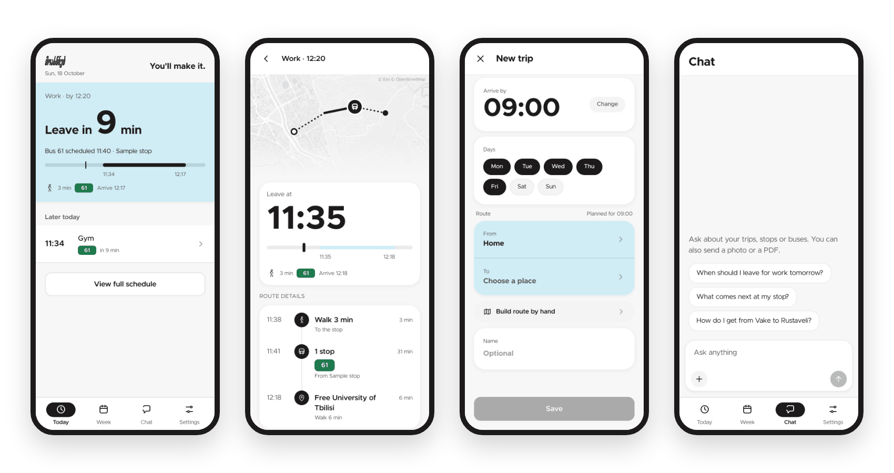</p>

<p align="center"><b>▶ <a href="https://drive.google.com/file/d/10gHC7BZdNcD1FLhUqrHzMBLTnKve7O2s/view?usp=sharing">Watch the demo video</a></b></p>

Built at Hacktoberfest Georgia 2026 (Free University of Tbilisi, 17-18 October).

## The problem and the idea

Getting to work or class in Tbilisi means guessing: which of three buses, which minibus, when to leave the house, and whether today's delay changes any of it. Journey planners answer "how do I get there now", not "when do I have to walk out the door to be there at 09:00".

Moaswreb starts from the deadline. You save the trips you repeat with an arrive-by time, and the Today screen counts down to the minute you should leave, comparing every bus, minibus and metro line against live arrival data. A phone alert and an AI assistant that can read a photo of a timetable or a city notice take care of the rest.

## Why this app, and what it is not

მოასწრებ is not a new kind of AI tool, and it does not try to replace anything. Getting to a place on time in Tbilisi already works, in pieces: the TTC app knows the buses, a maps app knows the streets, a calendar or a message knows when you have to be there, and an alarm clock is what wakes you. None of these talk to each other well, so the person is the glue: you look up the bus, work out the walk, subtract it from the time you must arrive, set an alarm, and check again if the bus is late.

Our argument is that the useful thing is the **connection**, not another source of data:

- **One question, answered backwards.** You say when you must arrive; the app works out the rest from live TTC data and gives you one time: leave at 08:14.
- **It keeps watching.** The plan is re-checked as the day goes on, and you are told when it changes (a different bus, a later departure), instead of finding out at the stop.
- **It uses what already exists.** TTC's own planner and live arrivals, OpenStreetMap and Google for places, a map for the route. We add the part that was missing between them: the arrival time, the repeat on your days, the walk, the buffer and the countdown.
- **AI is only the input.** The chat reads a photo or PDF of a timetable or a notice, or a sentence like "when do I leave for work?", and turns it into the same trips you could have made by hand. Every change still needs your tap, and the numbers come from TTC data, not from the model.

It is a small, practical tool that makes several mediocre-fitting apps work as one good routine.

## Download

**[Download the Android APK (v0.1.0)](https://github.com/gigoshkin/hacktoberfest/releases/latest)**

[](https://github.com/gigoshkin/hacktoberfest/releases/latest)

1. Open the APK on your phone. If Android asks, allow installs from your browser or file manager.
2. If Play Protect warns about an unrecognised developer, tap More details, then Install anyway. The app is not on the Play Store yet.

Or run it from source with Expo Go in a few minutes: [Run it](#run-it).

## Features

- **Today countdown.** "Leave in N min" for your next trip, with the boarding time, the arrival time and a progress bar from now to arrival.
- **Plan by arrive-by time.** Save a trip with the time you need to be there and the days it repeats (Mon-Fri by default, any combination). The Week tab shows all of them.
- **Every TTC line compared.** Buses, minibuses and metro are compared link by link against the same deadline, not just the three options TTC's own planner returns. Live vehicles replace the timetable while TTC reports them.
- **Avoid lists, per trip.** "Never line 518" or "no minibuses" for one trip without affecting the others.
- **Route builder.** Choose From and To by searching a street, place, stop or "Current location", or drop a pin on the map. Or build the route from scratch as a chain of steps: a start pin, walks, rides on a line between two stops, an end pin. Tap a stop, see the lines that serve it on the map, pick one, choose where to get off, add another ride or finish. Undo included.
- **Saved routes stay put.** "Save this route" pins the exact chain of rides you picked (for example 321, then metro 1, then 490), so the trip keeps showing that route instead of whatever is fastest today.
- **Google route ideas, TTC timings.** When a Google Routes key is configured on the server, Google suggests which line chains to consider and TTC times every one of them. Without a key the app uses TTC alone.
- **Never an empty answer.** If no ride can make the deadline any more, the trip shows "late" with the next ride and the fastest option, rather than "No route found".
- **Road shapes.** Rides are drawn along the road where TTC's planner gives a geometry, otherwise straight between stops.
- **AI assistant.** One chat input that understands text, photos and PDFs: a screenshot of a timetable, a photo of a notice, a Georgian TTC announcement. It answers in English, shows cards with real numbers from TTC data (stops, arrivals, plans) and proposes trips you confirm with one tap, with a name and days filled in. Paste a Google Maps link (full or shortened) and it turns the From and To into a trip.
- **Alerts.** A push notification "Leave in 10 min", and "Departure time changed" when the plan moves by 3 minutes or more. Works with the app closed.
- **Lock-screen leave card (Android development build or APK).** An ongoing notification that counts down to the leave time, from 30 minutes before, and stays current while the plan changes (the leave time, a progress bar, "switch to 17" when your line runs late). Tapping it opens the trip.
- **First-open intro.** Three skippable screens; notifications are asked for on the last one only.
- **English only.** No sign-up and no accounts. TTC's Georgian stop names are still searchable.

## Screenshots

These are real screenshots of the app's web preview (Expo web, 390x844 at 2x), not mock-ups. They run on the built-in **sample data** (the sample plan with a placeholder stop name), because no server was connected. The map screens (route builder, pin picker) need the native map module and do not render on the web, so they are not shown here. The assistant chat is shown without replies for the same reason (no server and no AI key).

| Today | Trip detail | New trip |
|---|---|---|
| 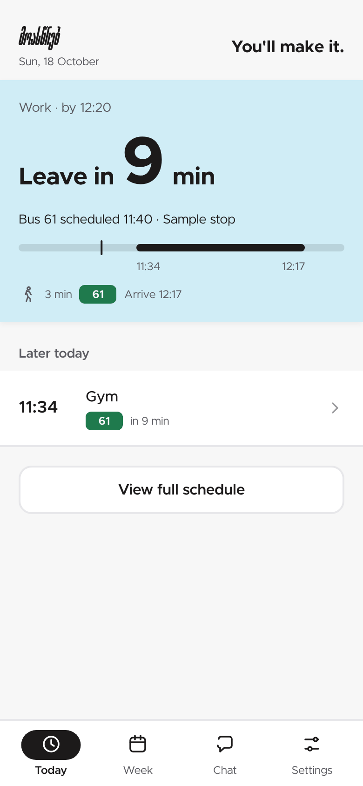 | 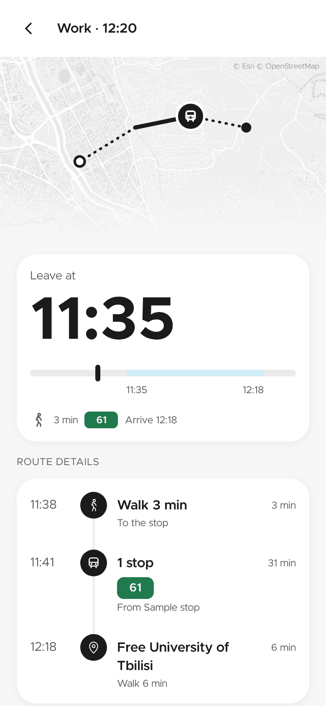 | 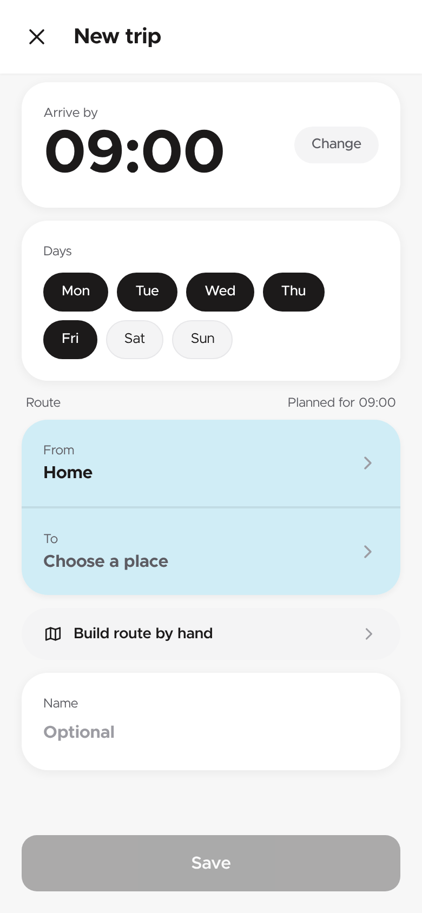 |

| Week | Assistant | Settings |
|---|---|---|
| 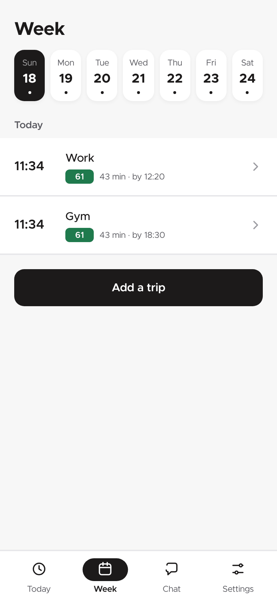 | 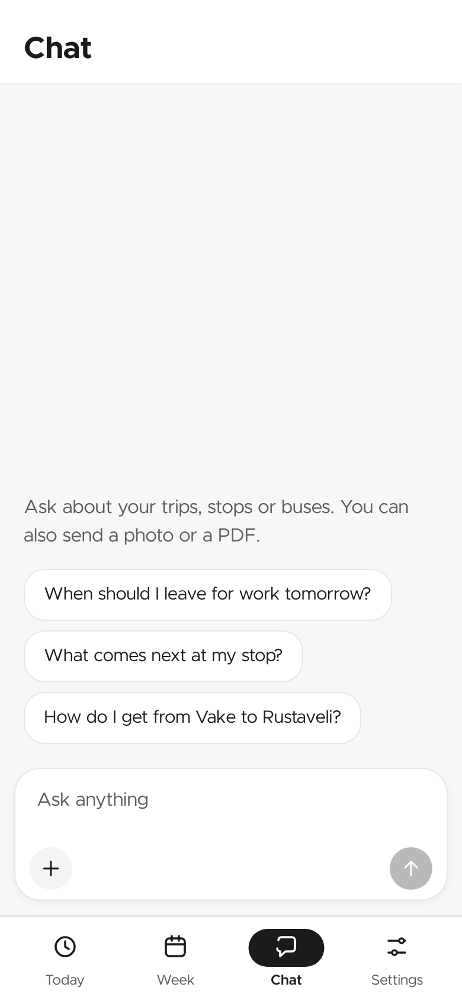 | 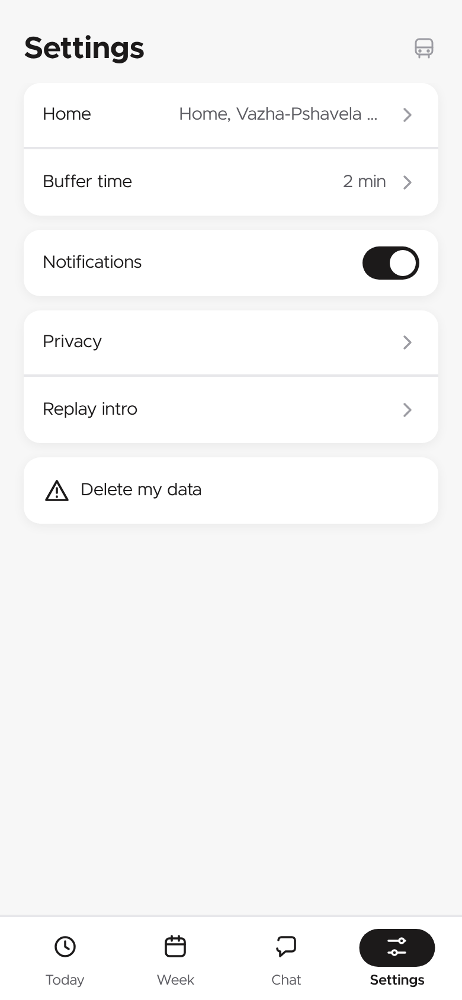 |

| Intro 1 | Intro 2 | Intro 3 |
|---|---|---|
| 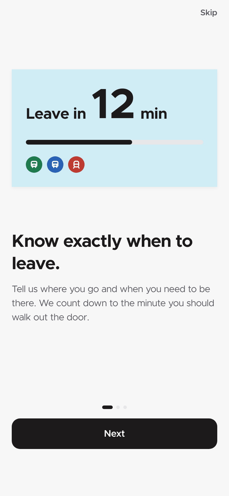 | 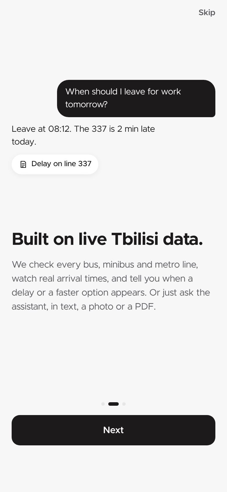 | 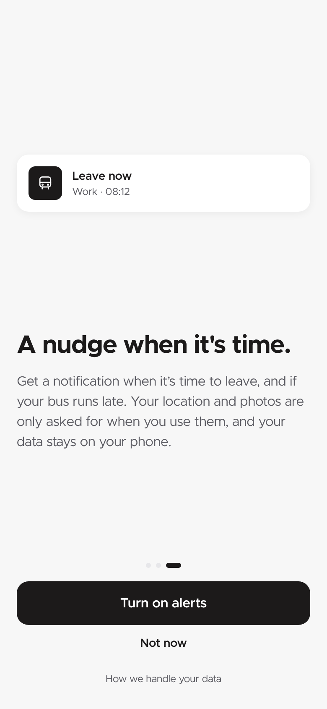 |

## How it works

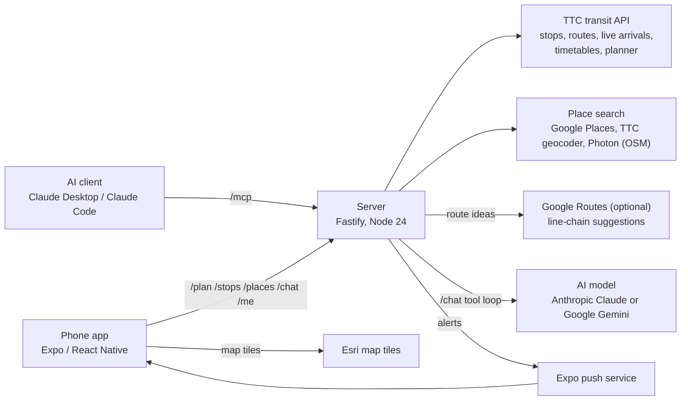

- The **phone app** holds the trips, settings and the chat on the device. It plans with the same rule as the server, so numbers agree.
- The **server** wraps TTC's public API behind a request queue, runs our own journey planner (every line compared link by link, solved backwards from the arrive-by time, optionally seeded with Google Routes suggestions that TTC data then times), searches places, runs the chat tool loop, and watches saved trips to send alerts.
- **Numbers in chat cards always come from TTC data, not from the model.** The model picks tools and writes one short sentence.
- The same read-only tools are exposed to AI clients over [MCP](#use-it-from-an-ai-client-mcp).


## Use it

| Screen | What it does |
|---|---|
| **Intro** | Three screens on first open. Skip any time; Settings, "Replay intro" shows it again. |
| **Today** | The next trip as "Leave in N min", with boarding and arrival times. Later trips today are listed under it. "Add a trip" appears while there are none. |
| **Trip detail** | Tap a trip. Map, the leave-at time, each step with its time, and "All ways to get there": every line option, grouped like Google Maps (an arrow means you change, stacked numbers are alternatives for the same ride). Tap one to open it, or say this trip never uses that line. |
| **New trip** | Step 1: the arrive-by time and the days. Step 2: From and To (search, "Current location" or pin), or "Build route by hand". Optional name. |
| **Route builder** | Start from nothing: drop a start pin (a stop starts a ride, anywhere else starts a walk), see every line at the stop, choose one, tap the stop to get off, add another ride or walk, then an end pin. Line switches per ride and up to 20 undo steps. A metro station within 250 m is offered, never chosen for you. |
| **Week** | Seven days with the trips that run on each. |
| **Chat** | Ask "When should I leave for work tomorrow?", "What comes next at my stop?", paste a Google Maps link, or attach a photo or PDF of a timetable. Trips it proposes are saved only when you confirm. |
| **Settings** | Home address, extra buffer time (0 to 15 min), notifications, privacy, replay intro, delete my data, and the app version (the build and commit, so you know which build you are testing). Tapping the Version row seven times opens a developer menu with test notifications and a test route. |

## Run it

Needs Node 24 or newer and npm. The repository is an npm workspace (`apps/mobile`, `apps/server`, `packages/shared`).

### Quick start with Expo Go (phone or browser)

```bash
git clone https://github.com/gigoshkin/hacktoberfest.git
cd hacktoberfest
npm install
cd apps/mobile
echo "EXPO_PUBLIC_API_URL=https://<your server>" > .env   # optional, see below
npx expo start --go
```

Open the QR code (or the `exp://` address) in **Expo Go for SDK 58** (58.0.4 or newer). Without `EXPO_PUBLIC_API_URL` the app shows synthetic sample trips, which is enough to look around. `npx expo start --web` renders the screens in a browser (layout only, no maps).

In Expo Go, storage falls back to SQLite and alerts are off. iOS blocks plain `http://` servers except on the local network, so use `https://` for anything real. Details: [apps/mobile/README.md](apps/mobile/README.md), testing on iPhone.

### Server

```bash
cp .env.example .env            # then edit
docker compose up -d --build server
curl localhost:8080/logger/stats
```

Or without Docker: `npm run dev -w @transit/server`. On a VPS, `docker compose --profile vps up -d --build` adds Caddy with automatic HTTPS (set `DOMAIN`). Tests: `npm test -w @transit/server`.

| Variable | Purpose |
|---|---|
| `API_KEY` | Bearer key the app and AI clients send to `/chat`, `/mcp`, `/me`. Ships inside the app, so it slows abuse; it is not a secret. Leave empty for local development. |
| `TRIPS_KEY` | 32-byte key (`openssl rand -base64 32`) that encrypts stored trips. Without it stored trips and alerts are off. |
| `AI_PROVIDER` | `anthropic` or `gemini`. Unset: Anthropic if its key is set, else Gemini. |
| `ANTHROPIC_API_KEY`, `ANTHROPIC_MODEL` | Enables `/chat` with Claude (default model `claude-sonnet-5-5`). |
| `GEMINI_API_KEY`, `GEMINI_MODEL` | Enables `/chat` with Gemini (free key from Google AI Studio is enough for testing). |
| `GOOGLE_PLACES_API_KEY` | Optional. Google Places as the first place-search source; empty means off. `GOOGLE_PLACES_DAILY_CAP` limits real calls per day. |
| `GOOGLE_ROUTES_API_KEY` | Optional. Google Routes (transit) suggests line chains the trip planner then times from TTC; empty means TTC only. `GOOGLE_ROUTES_DAILY_CAP` (default 300) limits real calls per day. |
| `DOMAIN` | Public hostname for Caddy on the VPS. |

All variables, rate limits and the endpoint list are in [.env.example](.env.example) and [apps/server/README.md](apps/server/README.md).

### Development build (push alerts and the leave card)

Expo Go cannot run push notifications or the lock-screen card. They need a development build of the app, made once in the cloud with EAS; after that JavaScript changes reload from Metro.

Step-by-step build guide (Expo Go, Android APK, iPhone): [docs/build.md](docs/build.md).

## Build the APK

This is the way to produce the downloadable Android build. Profiles are in `apps/mobile/eas.json`: `preview` is a standalone APK that needs no Metro (use it for demos), `development` is the dev client.

```bash
cd apps/mobile
npx eas-cli@latest login                 # Expo account
npx eas-cli@latest init                  # first time only: creates the EAS project
npx eas-cli@latest build --profile preview --platform android
```

EAS prints a download URL and QR code when the build finishes. Set `EXPO_PUBLIC_API_URL` for the build (for example as an EAS environment variable) so the APK talks to the real server. There is no local `expo run:android` without an Android SDK; EAS builds in the cloud. A build takes roughly 15-30 minutes plus the queue.

## Use it from an AI client (MCP)

The server exposes the same read-only transit tools at `/mcp` (streamable HTTP, stateless). Remote clients need HTTPS, so it is meant for the VPS behind Caddy.

```bash
claude mcp add --transport http tbilisi-transit https://<DOMAIN>/mcp \
  --header "Authorization: Bearer <API_KEY>"
```

Claude Desktop: add it as a custom connector (not tested yet).

| Tool | What it does |
|---|---|
| `find_stop` | Find a stop by name or code (Georgian or English). |
| `find_place` | Geocode a street or place in Tbilisi. |
| `next_arrivals` | Live countdown of the next vehicles at a stop. |
| `plan_trip` | Arrive-by trip planner across all lines. |

Other tools (`stops_near`, `lines_at_stop`, `parse_maps_link`, `propose_trip`, `propose_route`, `propose_events`) are used by the in-app chat: they read a Google Maps link or return cards the user confirms in the app.

## Tech stack

| Layer | What |
|---|---|
| App | Expo SDK 58, React Native 0.88, expo-router, TypeScript, Reanimated, react-native-maps, MMKV (SQLite in Expo Go) |
| Notifications | expo-notifications, react-native-notify-kit (Android leave card) |
| Server | Node 24, Fastify, TypeScript run directly by Node, built-in SQLite, MCP SDK |
| AI | Anthropic Claude or Google Gemini, chosen with `AI_PROVIDER` |
| Data | TTC transit API, Google Places and Google Routes (both optional), Photon / OpenStreetMap |
| Maps | Esri Light Gray Canvas tiles |
| Build and deploy | EAS Build, Docker Compose, Caddy |
| Fonts | Metropolis (public domain) |

## Project structure

```
apps/
  mobile/       Expo app. src/app (routes), src/ui (design system), src/lib (api, plans, trips, alerts)
  server/       Fastify server. src/journey (planner), src/ttc (TTC + places), src/tools (chat + MCP),
                src/alerts (watcher), src/store (encrypted trips)
packages/
  shared/       Types and the leave-time rule shared by app and server
deploy/         Caddyfile
docs/           README images
```

## Data sources and attribution

- **Transport data:** TTC (Tbilisi Transport Company) public transit API: stops, routes, timetables, live positions and arrivals, walking and trip planning.
- **Places:** OpenStreetMap data through TTC's geocoder and [Photon](https://photon.komoot.io); Google Places (New) when enabled.
- **Route ideas:** Google Routes (transit) when enabled, used only to suggest which lines to chain. All times come from TTC.
- **Map tiles:** Esri Light Gray Canvas, with attribution on the map (OpenStreetMap contributors where shown).
- **Live accuracy:** TTC's predictions are about 1-1.5 minutes off up to 10 minutes ahead in our measurement (details). Our planner is not affiliated with TTC.

## Privacy

There are no accounts. Trip names, addresses, your home and the chat history stay on the phone, and location is used on the phone only. For alerts the server stores, encrypted, only each trip's first and last stop, arrive-by time, days and walk minutes, plus the push token; it is deleted after 30 days without use, or at once with "Delete my data". Chat messages, photos and PDFs go to the AI provider to be read and are not stored by our server. The in-app Privacy screen lists what third parties see.

## Team

- George Kiknadze ([@gigoshkin](https://github.com/gigoshkin))
- Andro Petrosyan ([@AndroPetrosyan](https://github.com/AndroPetrosyan))

Code was written with Claude Code (Anthropic) under the direction of both authors.

## Licence

Copyright (c) 2026 George Kiknadze and Andro Petrosyan. All rights reserved. This is proprietary software and the intellectual property of its authors; see [LICENSE](LICENSE). The source is public for evaluation only.
